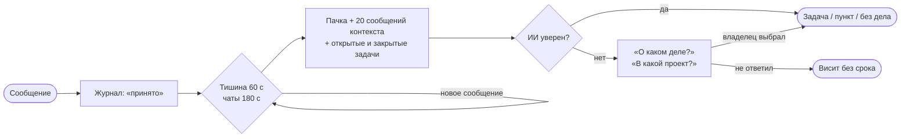
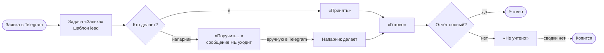

# Разбор проекта новыми навыками — 2026-11-19

Навыки: `process-mapper` (процессы как есть и как надо), `business-rule-extractor` (правила),
`requirements-interrogator` (проверка требований), `ui-ux-pro-max` (интерфейс), `mobile-android-design` (Android).
Источники: `CONCEPT.md`, `registry/`, `src/tasks/`, `web/`, `android/`; экран проверен в браузере на ширине телефона
375 px на вымышленных данных. На телефоне владельца и на реальных сообщениях не проверялось.

## Коротко — что важнее всего

1. **Вечерняя сводка — сток без выхода.** Туда по концепции уходят: незаполненные отчёты («Не учтено»), вопросы без
   ответа за день (§3.2), звонки без описания (§8.1), недостающие поля (§2.6), застывшие проекты (§2.11). Сводки нет
   (шаг 6). Значит, всё это сейчас копится молча — ровно то, от чего система должна спасать (§1).
2. **Нет замеров процесса.** Концепция мерит качество разбора долей «принято без правок» (§3.1), но ни одно число не
   считается и нигде не видно: сколько не разобрано, сколько правок, сколько от сообщения до задачи.
3. **Разбор менялся трижды (v6 → v8) без прогона по `golden/`** — нарушение правила 11. Эталонный набор: 28 из 50.
4. **«Поручить…» не отправляет сообщение** — передача дела напарнику идёт мимо системы, и «Контроль» не знает, принял ли он.
5. **Интерфейс:** заголовок прилип к левому краю, счётчик «1 бесед ждут ответа», кнопки 40 px вместо 44–48.

## 1. Процессы (process-mapper)

**Уровень 1 — цепочка ценности владельца:** обращение клиента → договорённость → выезд или удалёнка → оплата и
отчёт → проверка «всё работает?» → отзыв. Stream сейчас покрывает первые два звена и «готово»; отчёт, оплата,
проверка и отзыв — в плане (§7 после MVP).

### 1.1 «Сообщение → дело» (разбор)

| | |
|---|---|
| Начало | событие записано в журнал (приложение, Telegram BY/PL, телефон) |
| Конец | у сообщения есть итог: новая задача, существующая задача или «без дела» |
| Дорожки | источник · сервер (журнал, окно тишины) · ИИ-разбор · владелец |
| Владелец процесса | владелец; исполнитель разбора — ИИ (`triage-ai-v8`) |

Узкие места:
- ветка «не ответил» никуда не ведёт: вопрос остаётся на сообщении, в сводку не попадает (сводки нет);
- передача «ИИ → владелец» не измеряется: сколько вопросов задано, сколько отвечено, сколько правок после.

### 1.2 «Заявка клиента → выполнено → учтено»

Узкие места: две пунктирные передачи — поручение напарнику и путь «Не учтено» → сводка. Проверка после выезда и
просьба об отзыве (§7, этап 3) — не построены.

### 1.3 Как должно быть (порядок по Хармону: убрать → упростить → объединить → автоматизировать)

| Изменение | Сейчас | Как надо | Вид |
|---|---|---|---|
| Сводка как единый выход | 5 источников «на вечер», выхода нет | минимальная вечерняя сводка — список без ИИ: не учтено, вопросы без ответа, звонки без описания, проекты без шага | убрать сток |
| Замеры | нет | на экране «Система»: не разобрано, вопросов без ответа, доля правок разбора за неделю, от сообщения до задачи | упростить |
| Поручение | только запись в задаче | после «да» — сообщение напарнику через бот (класс C); ответ «принял» — статус | объединить |
| Прогон разбора | вручную, не делался | скрипт прогона по `golden/` перед сменой версии разбора, итог в `decisions.md` | автоматизировать |

Голос → текст (шаг 2) намеренно не в этой таблице: он про ввод, а не про потерю дел.

## 2. Правила (business-rule-extractor)

Подтверждённые — записаны в концепции или реестре; выведенные — следуют из кода или сочетания правил.

| # | Правило | Источник | Статус |
|---|---|---|---|
| R1 | Разбор ждёт тишины 60 с после последнего сообщения беседы; в Telegram — 180 с | `registry/tasks.json` | подтверждено |
| R2 | Закрытое дело, о котором пишут снова в течение `job_days` (14), возвращается с новым пунктом | §2.8, `planner.ts` | подтверждено |
| R3 | Закрытая задача, которую явно продолжают в течение `reopen_days` (30), открывается снова | §2.8, `triage.ts` | подтверждено |
| R4 | Разбор не переименовывает задачу, названную владельцем, и не переносит задачу, которую владелец положил в проект | §2.8, §2.11 | подтверждено |
| R5 | Наружу ничего не уходит без «да»; отправка ответа и есть «да» | §2.10, §8.2 | подтверждено |
| R6 | Класс C становится автоматическим только для шаблонных сообщений и после 20 подтверждений подряд без правок | §3.1 | подтверждено, не построено |
| R7 | Бот отвечает в личный чат только в течение 24 ч после входящего | §8.2 | подтверждено (ограничение Telegram) |
| R8 | Беседа «ждёт меня», если последнее значимое сообщение входящее и без ответа; «ок, спасибо» с итогом «без дела» не ждёт | §2.5 | подтверждено |
| R9 | Новое сообщение после отметки «в архив» возвращает беседу из архива | §2.5 | подтверждено |
| R10 | Задачи, где у меня нет роли, не попадают в мои списки и не делают беседу «ждёт меня» | §2.8 | подтверждено |
| R11 | Идея о проекте — задача в его разделе «Идеи», не в «Сегодня»; идея без подходящего проекта — шаблон `plan` (в архив) | §2.11, `planner.ts` | подтверждено |

**Столкновения и пробелы:**
- **R2 × R3, 14–30 дней.** Дело закрыто 20 дней назад, клиент пишет «опять сломалось». По R3 задача
  открывается снова, по R2 срок «вернуть дело с пунктом» уже прошёл — значит, новая задача? Модели решать самой.
  ❓ Нужно одно правило: например, «после `job_days` — новая задача со ссылкой на старое дело».
- **Два «Архива».** Кнопка «Архив» сверху показывает архивные *сообщения* (§2.4) и раскрывает архивные *беседы*
  (§2.5) — разные вещи под одной кнопкой; смахивание беседы пишет правку `answered`, а не `archive`. Не ошибка, но
  легко запутаться при поиске «куда делось».
- **Нет срока у вопроса разбора.** §3.2 говорит «нет ответа за день — в сводку», для «О каком деле?» и «В какой
  проект?» такого правила нет.
- **`quiet_s_by_stream`** задан только для Telegram; для звонков и SMS — 60 с, хотя после звонка описание
  приходит позже. ❓ Проверить на практике, не режет ли разбор звонок от его описания.

## 3. Требования (requirements-interrogator)

**Непроверяемые формулировки** (переписать в проверяемые, когда дойдёт черёд):

| В концепции | Проверяемо |
|---|---|
| «всё появляется и уходит плавно» (§5) | любая смена высоты блока — анимация ≤ 250 мс; при «уменьшить движение» — 0 мс |
| «разбор дёшев, ~$10 в месяц» (§6) | расход за месяц виден на «Система»; при 80% лимита — служебное сообщение |
| «ничего не теряется» (шаг 1) | у каждого сообщения старше `quiet_s` + 5 мин есть итог разбора; иначе счётчик «не разобрано» |

**Вопросы по риску (первые — важнее):**
1. Что минимально должно быть в вечерней сводке, чтобы она закрыла пять «стоков» — и когда её делать: до шага 2 или после?
2. Готовы ли вы, чтобы «Поручить…» после «да» отправляло сообщение напарнику через бот BY/PL уже сейчас (до бота задач)?
3. R2 × R3: дело, закрытое 14–30 дней назад, — новая задача или то же дело?
4. Добрать эталонный набор до 50 и прогнать `triage-ai-v8` — до продолжения П15?
5. Номер телефона в заметке → контакт и беседа: варианты A/B/C (предлагались ранее) ждут выбора.

**Допущения, на которых сейчас стоит система:** один владелец; Telegram только через ботов; клиентские сообщения
идут в Anthropic API (условия использования данных для API — проверить и записать в `decisions.md`, §6 этого
требует); телефон владельца — Android 10+ (minSdk 29).

## 4. Интерфейс (ui-ux-pro-max), телефон 375 px

| # | Что | Где | Важность |
|---|---|---|---|
| U1 | Заголовок «Задачи / Беседы» прилип к левому краю (2 px), а список — с отступом 14 px | `web/panels.css:45` перебивает 16 px из `styles.css:44` | высокая, правка в одну строку |
| U2 | Подпись счётчика «1 бесед ждут ответа» — не согласовано число | `web/viewswitch.js:44` | высокая (читает экранный диктор) |
| U3 | Кнопки 40 px: чипы списков, «связь», переключатель, «Все списки» (36×40) — меньше 44–48 | `styles.css` | средняя |
| U4 | Технический текст ошибки на английском во всплывающем сообщении (отказ service worker) | регистрация в `app.js` | средняя — показывать «Офлайн недоступен», подробности — в «Система» |
| U5 | Пустой «Сегодня» показывает только свёрнутое «Дальше 4» — нет строки «На сегодня всё» | `tasklist.js` | средняя |
| U6 | Окно «связь»: строки бесед и задач без боковых отступов, текст обрезан без «…» | `linkwindow` CSS | средняя |
| U7 | Поле срока — системное «dd.mm.rrrr» (польская маска) без подписи | подробности задачи | низкая |
| U8 | Поле «Пункт» чеклиста — подпись только подсказкой внутри поля | `checklist.js` | низкая |
| U9 | Кнопка «Готово»: белый на синем, контраст 4,14 (нужно 4,5) | `styles.css` | низкая |
| U10 | В открытой беседе две шапки подряд (вид + имя беседы) — ~120 px из 812 | шапка беседы | низкая — можно слить в одну с «‹» |
| U11 | Символы вместо значков: ☐ ☑ ↗ 📞 ✉ — разный вид на разных телефонах | `checklist.js`, лента | низкая |

Что в порядке: основной текст 16 px, контраст текста ≥ 4,5 почти везде, у кнопок-значков есть подписи для
экранного диктора, учтены «уменьшить движение» и вырезы экрана. Светлая тема не проверялась.

## 5. Android-приложение (mobile-android-design)

Приложение — один экран настроек и уведомление после звонка; Compose и Material 3 здесь были бы избыточны
(правило 14 — простая доработка). Замечания:
- **A1.** Адрес сервера и токен подписаны только подсказкой внутри поля: после ввода не видно, какое поле что.
  Подпись над полем (`TextView`) или `TextInputLayout`.
- **A2.** Тема `DeviceDefault.DayNight` — нормально; динамические цвета Android 12+ придут бесплатно только с
  Material Components. ❓ Не нужно, пока экран один.
- **A3.** Разрешения просятся одной кнопкой все сразу. Если отказать с «больше не спрашивать», кнопка молча ничего
  не делает — стоит показывать «Открыть настройки приложения» (кнопка уже есть ниже, но без связи с отказом).
- **A4.** Уведомление «О чём был звонок?» — сделано по правилам: канал высокой важности, ответ прямо из шторки,
  «Сохранено» исчезает само.

## Что дальше (предложение)

1. Мелкие правки интерфейса U1–U3, U5, U6 — одной правкой, быстро.
2. Минимальная вечерняя сводка и счётчики на «Система» — закрывают главный риск.
3. Добрать `golden/` и прогнать разбор.
